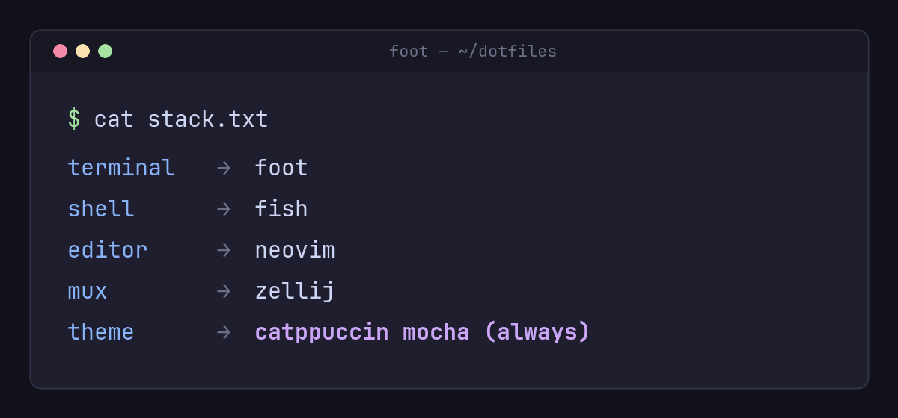

Annual tradition: documenting the terminal stack before I inevitably change all of it again by December.

This year's lineup: foot as the terminal, fish for the shell, neovim (obviously), and zellij after finally admitting tmux config had become archaeology. Everything themed Catppuccin Mocha, everything pinned via the flake in my dotfiles repo.

The biggest quality-of-life win was small: a fish abbreviation that expands `,g` to `git`. Saved keystrokes measured in the dozens, satisfaction immeasurable.

Next year's prediction: I say I won't touch it, and then I touch it. ᕕ( ᐛ )ᕗ
